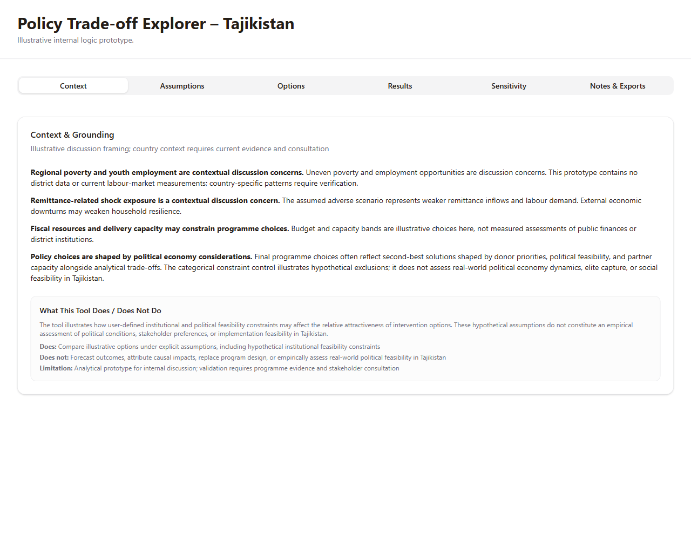
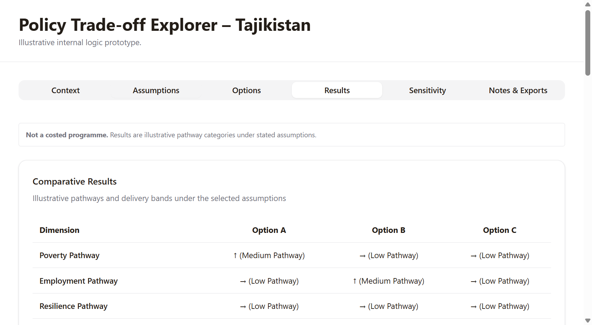
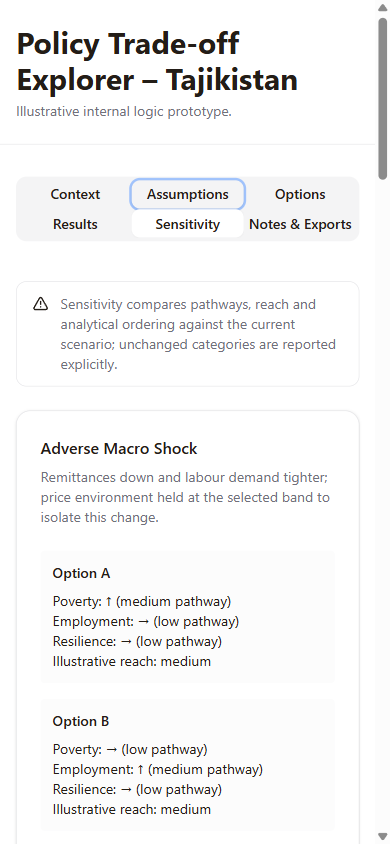

# Policy Trade-off Explorer – Tajikistan

**Illustrative internal logic prototype.** An independent student portfolio project for exploring how explicit assumptions may affect the relative attractiveness of development intervention options.

This project is not affiliated with, commissioned by, used by, or endorsed by UNDP. Tajikistan provides a contextual discussion setting; the application does not contain calibrated country programme data or an empirical assessment of its institutions.

Repository: [yunusovmatin/policy-tradeoff-explorer-tajikistan](https://github.com/yunusovmatin/policy-tradeoff-explorer-tajikistan).

Live demonstration: **[Open the public Policy Trade-off Explorer](https://policy-tradeoff-explorer-tajikistan.vercel.app/)** (Vercel production deployment from GitHub `main`).

## Purpose and features

The application makes assumptions inspectable and keeps analytical pathways separate from illustrative resource reach. It supports discussion rather than forecasts, causal attribution or operational resource allocation.

The six sections are Context, Assumptions, Options, Results, Sensitivity, and Notes & Exports. Discrete controls cover demand/remittance conditions, prices, delivery capacity, outcome conversion, leakage, assessment horizon, budget and costs. The three packages are social protection, youth employment, and resilience/climate investment.

Results show poverty, employment and resilience pathways, delivery reach, package lag, asymmetric implementation risks and shock robustness. Categorical ordering uses a declared comparison focus and preserves legitimate ties. Hypothetical None / Moderate / Severe constraints filter eligibility; no eligible option means no invented fallback. A second-best indicator appears only when a unique actual second analytical option becomes the unique eligible leader. Rejection reasons, viability conditions and risk flags explain the stated rules.

Sensitivity applies three separate changes: adverse macro conditions, low capacity and high leakage. Decision confidence describes leading-group/pathway stability under these tests and constraints, not statistical confidence or programme success probability.

Scenario recording is held in memory for the open page session and cleared on reload. Comparison explicitly concerns analytical results before feasibility constraints and lists differing assumption categories. The CSV is a **single-scenario transparency snapshot**, including clearly labeled underlying numeric assumptions. It is not for forecasting, optimisation, scenario comparison or downstream analytical reuse.

## Screenshots

These images were captured from the reviewed local production preview; they do not establish a public deployment.





## Architecture and stack

| Layer | Implementation |
| --- | --- |
| Interface | React 19, TypeScript, Tailwind CSS, shadcn/Radix components |
| Build | Vite 7, pnpm lockfile, esbuild for the optional static server |
| Logic | Pure, local TypeScript conventions; no data service or model inference |
| Tests | Vitest; 30 tests across analytical and comparison-rendering suites |
| Hosting | Static output in dist/public; optional Express static server in dist/index.js |

```text
client/src/pages/Explorer.tsx                 Six sections and in-memory assumptions/session state
client/src/lib/tradeoffLogic.ts               Pathways, reach, categorical ordering, sensitivity, CSV
client/src/lib/tradeoffLogicEnhanced.ts       Eligibility, overrides, conditions and confidence
client/src/components/EnhancedResultsTable.tsx
client/src/components/SensitivityView.tsx
client/src/components/ScenarioComparison.tsx
client/src/lib/tradeoffLogic.review.test.ts    27 analytical regression tests
client/src/components/ScenarioComparison.test.tsx  Three comparison tests
server/index.ts                              Optional static hosting only
```

The active route is Explorer at `/`. Inactive template components remain in the source but are not mounted by that route; their example authentication, map integration or custom-package storage does not form part of this application. No runtime credentials, external data fetching, authentication, persistent scenarios or AI calls are required. Deployment tools and release metadata are outside the application's analytical behavior.

## Install and run

Use Node.js 24.14.0 (recorded in .nvmrc) and pnpm 10.4.1 (declared by package.json). From the repository root:

```sh
npx --yes pnpm@10.4.1 install --frozen-lockfile
npx --yes pnpm@10.4.1 run dev
```

Open the local address printed by Vite. Do not copy inherited hosting credentials or set Manus/OAuth/AI environment variables. There are no required application secrets.

## Checks and production build

```sh
npx --yes pnpm@10.4.1 run check
npx --yes pnpm@10.4.1 exec vitest run
npx --yes pnpm@10.4.1 run build
npx --yes pnpm@10.4.1 run preview
```

The complete regression suite contains 30 tests. It covers control-to-output coherence, resource arithmetic, focus-specific ordering and ties, feasibility distinctions, empty eligibility, supported second-best status, sensitivity, confidence, CSV quoting/fidelity, and session-comparison disclosures. Tests establish behavior under declared conventions, not empirical validity.

The site to publish is `dist/public`, not the entire working folder. The optional Node server can serve the same output. For a verified Git checkout, `node scripts/prepare-release.mjs` adds a commit/asset-hash manifest to the build without changing the UI. See [DEPLOYMENT.md](DEPLOYMENT.md).

## Limitations

- Coefficients, thresholds, evidence judgments, risk/robustness categories and eligibility rules are unvalidated demonstration conventions. They do not estimate national poverty, employment or resilience effects.
- Resource reach has no population denominator and is not population coverage or economic efficiency. Budget and costs affect reach separately from per-participant pathways.
- Geographic targeting and population weighting are contextual discussion lenses; no district allocation is calculated.
- Current nonnegative pathway indices do not generate deterioration scenarios. Three single-factor stress tests do not cover joint shocks, threshold uncertainty or alternative coefficient sets.
- Decision confidence is model-internal. High does not mean every output is stable or that implementation would succeed.
- Hypothetical constraints are not a verified assessment of political conditions, stakeholder preferences or implementation feasibility in Tajikistan.
- Desktop/mobile and keyboard checks support basic accessibility; a full screen-reader and real-device audit remains outstanding.

[ANALYTICAL_RULES.md](ANALYTICAL_RULES.md) documents the numerical demonstration conventions. Real programme choices require evidence, political dialogue, partner consultation and fiduciary review.

## Development acknowledgment

Drafting and prototyping supported by AI-assisted tools.

This acknowledgment does not establish institutional affiliation or external validation. The student presenting the project should be able to explain its assumptions, calculations, comparison rules, tests and limitations.
